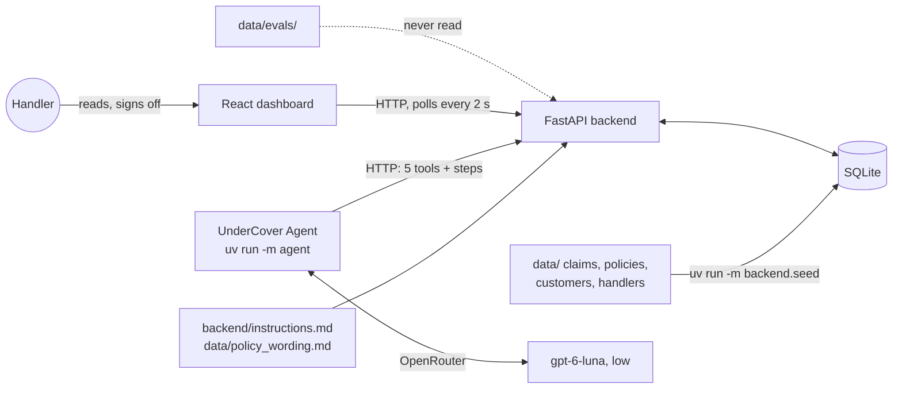
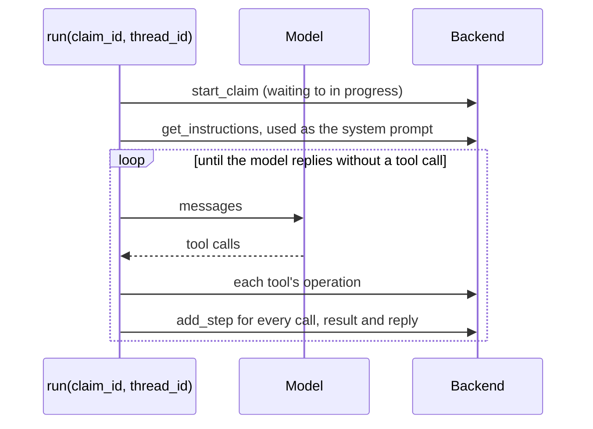
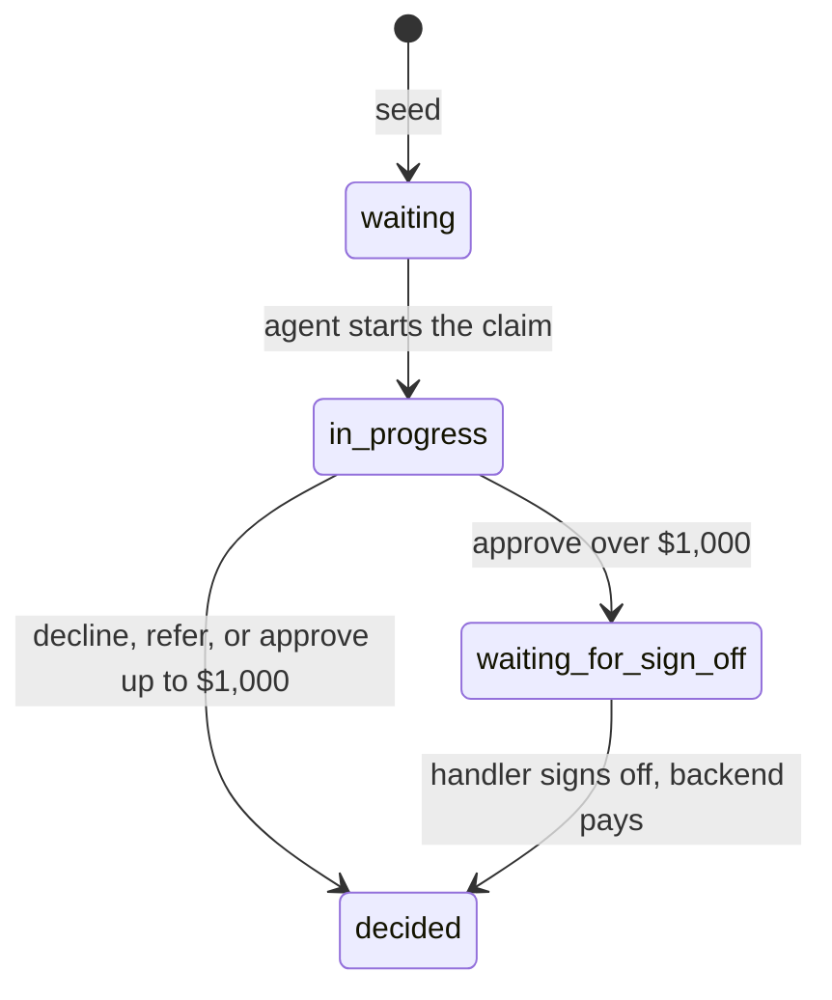

# Plan: the claims pilot

Builds `docs/SPEC.md` on the stack in `docs/TECH_STACK.md`, in six phases. For each phase: build it with tests, check every criterion, tick it here, update `docs/STATUS.md`, commit.

## How it fits together

One agent run:

## Claim lifecycle

| Status | Dashboard label |
|---|---|
| `waiting` | Waiting |
| `in_progress` | In progress |
| `waiting_for_sign_off` | Waiting for sign-off |
| `decided` | Decided |

An approval up to $1,000 is decided when recorded; the agent then pays it. Decisions are final: rerunning needs a reseed.

## Key decisions

| Decision | Why | Rejected |
|---|---|---|
| The $1,000 block lives in the pay operation: it never pays over $1,000, whatever the status. Only a handler's sign-off pays those | The spec says "even if the agent tries to pay", so the guardrail is code, not the prompt. Recording an approval over $1,000 also sets `waiting_for_sign_off`: two independent guards | Telling the agent not to pay |
| The backend serves the instructions: `GET /api/instructions` returns `backend/instructions.md` followed by the policy wording | TECH_STACK: the agent reaches its instructions only through the API. One source for the agent and the dashboard's read-only page | A prompt file in `agent/` |
| The policy wording goes in the system prompt, not a tool | Same for every claim and fits in a prompt (`data/README.md`), so it's a cacheable prefix | A `get_policy_wording` tool |
| Every read is a tool call, including the claim | Each read shows as a step on the dashboard. Costs one extra model call per claim | The claim in the first message |
| Tools are built per run, bound to that claim: the agent can't decide or pay another claim | Least privilege, a few lines of code | `claim_id` as a tool argument, as in Day 2 |
| `run()` posts steps from `agent.stream(stream_mode="updates")`; the dashboard polls every 2 s | The agent runs in its own process, so the backend relays. Polling is the simplest live view for a few local users | Server-sent events, websockets |
| Customer data: the API exposes name, customer since and claim history only | `customers.json` is personal data, and nothing in the pilot needs contact details | Serving the whole record |
| SQLite through stdlib `sqlite3`; seed records stored as JSON beside workflow columns; state changes are conditional `UPDATE`s | No ORM to learn; records are always read whole; two runs can't take the same claim | SQLAlchemy, normalized tables |
| End-to-end tests get their own database (`backend/e2e.db`) and ports (8001, 5174), seeded at start | The tests write fake decisions; they must never touch the queue the student works with the real model | Reseeding the shared database before each run |
| Hash routes (`#/claims/CLM-1001`, `#/instructions`) | Three views, no router dependency | react-router |
| Amounts are floats rounded to cents on input | The data and the model speak dollars; no real payments yet | Integer cents |

## API

Every operation has an `operation_id`, a one-line docstring and no optional inputs.

| `operation_id` | Route | Input | Used by |
|---|---|---|---|
| `health` | `GET /api/health` | | Playwright readiness |
| `list_claims` | `GET /api/claims` | | dashboard, agent CLI |
| `get_claim` | `GET /api/claims/{claim_id}` | | agent, dashboard |
| `get_policy` | `GET /api/policies/{policy_id}` | | agent, dashboard |
| `get_claim_history` | `GET /api/customers/{customer_id}/history` | | agent, dashboard |
| `list_handlers` | `GET /api/handlers` | | dashboard |
| `get_instructions` | `GET /api/instructions` | | agent, dashboard |
| `start_claim` | `POST /api/claims/{claim_id}/start` | | agent run |
| `add_step` | `POST /api/claims/{claim_id}/steps` | `kind`, `name`, `content` | agent run |
| `list_steps` | `GET /api/claims/{claim_id}/steps` | | dashboard |
| `record_decision` | `POST /api/claims/{claim_id}/decision` | `decision`, `payout`, `rationale`, `policy_section` | agent tool |
| `pay_claim` | `POST /api/claims/{claim_id}/payment` | `amount` | agent tool |
| `sign_off_claim` | `POST /api/claims/{claim_id}/sign-off` | `handler_id` | dashboard |

A claim carries the seed record plus `status`, `decision`, `payout`, `rationale`, `policy_section`, `paid_amount` and `signed_off_by`. A step is `kind` (`tool_call`, `tool_result` or `message`), `name` and `content`.

Payment rules. The limit is `payout_approval_limit` from `data/company.json`, read by the backend and formatted into the message, never a literal `1000` in code:

| `pay_claim` when | Response |
|---|---|
| amount over $1,000, or claim waiting for sign-off | 403 "Payouts over $1,000.00 need a handler's sign-off" |
| no approval recorded | 409 |
| already paid | 409 |
| amount differs from the approved payout | 409 |
| otherwise | 200, `paid_amount` set |

## The agent

| Tool | Operation |
|---|---|
| `get_claim()` | `get_claim` for this claim |
| `get_policy(policy_id)` | `get_policy` |
| `get_claim_history(customer_id)` | `get_claim_history` |
| `record_decision(decision, payout, rationale, policy_section)` | `record_decision` for this claim |
| `pay_claim(amount)` | `pay_claim` for this claim |

No tool signs off. A tool returns the backend's refusal (4xx) as text so the agent can explain it; a server error raises. `thread_id` is passed through; there is no checkpointer yet.

Draft of `backend/instructions.md`, built on Day 2's:

> You are the UnderCover Agent, a claims handler at UnderCover Travel Insurance. Decide the claim you are given against the policy wording below.
>
> 1. Read the claim with get_claim, then the customer's policy with get_policy and their earlier claims with get_claim_history.
> 2. Choose one decision:
>    - approve: the wording covers the claim and the required documents are attached. Work out the payout with section 10.
>    - decline: the wording does not cover the claim.
>    - refer: a person needs to look at it, because a required document is missing, the story and the documents disagree, or the wording does not settle the question.
> 3. Record it with record_decision: a rationale of two or three sentences, the section of the wording that decides it, and the payout in US dollars (0 for a decline or a referral).
> 4. If you approved a payout of $1,000 or less, pay it with pay_claim. A larger payout waits for a handler's sign-off, and the system will refuse to pay it.
> 5. Finish with one sentence on what you did.

## Phase 1: Database, seed and read API

**Builds:** `backend/db.py` (connection from `UNDERCOVER_DB`, default `backend/undercover.db`; schema), `backend/seed.py`, the seven read operations, `backend/instructions.md`. The seed loads `claims.json`, `policies.json`, `customers.json` and `handlers.json` by name, never a glob of `data/`, with every claim `waiting`. The backend seeds on startup when the database file is missing. Tests run on a fresh database in a temp folder.

**Why first:** everything else reads from it.

- [x] `uv run -m backend.seed` prints `Seeded 25 claims, 50 policies, 49 customers, 3 handlers`
- [x] pytest: the seeded claim ids are exactly CLM-1001 to CLM-1025, all `waiting`; reseeding resets a changed claim
- [x] pytest: starting the app with no database file creates and seeds it
- [x] `grep -rln evals backend agent` prints nothing
- [x] `curl localhost:8000/api/claims` returns 25 rows with `claim_id`, `summary`, `claim_type`, `amount_claimed`, `status`, `decision` and `payout`
- [x] `curl localhost:8000/api/claims/CLM-1001` returns the story, 3 items, 4 documents, `"status": "waiting"` and `"decision": null`
- [x] `curl localhost:8000/api/customers/CUS-3001/history` returns the name, `customer_since` and one previous claim (CLM-0412), with no email, phone, date of birth or address
- [x] `curl localhost:8000/api/instructions` returns the instructions followed by the policy wording, including "Version 2026.1"
- [x] An unknown claim, policy or customer returns 404
- [x] pytest walks `app.openapi()`: every operation has an `operation_id` and a one-line description, every parameter is required and every request body property is required
- [x] `npm run check:python` passes with coverage of at least 80%

## Phase 2: Claim workflow and the $1,000 rule

**Builds:** `start_claim`, `add_step`, `list_steps`, `record_decision`, `pay_claim`, `sign_off_claim`, with the transitions and payment rules above.

**Why now:** the rules are backend code, tested without any model, before an agent can call them.

- [x] pytest: `start_claim` moves `waiting` to `in_progress`; a second start returns 409
- [x] pytest: decline and refer go to `decided` and need a payout of 0; approve up to $1,000 goes to `decided`; approve over $1,000 goes to `waiting_for_sign_off`; approve with a payout of 0 returns 422; a decision on a claim that isn't in progress returns 409
- [x] pytest: an approval of $1,000.00 pays (200); an approval of $1,000.01 is refused (403) and `paid_amount` stays null
- [x] pytest: a claim approved for $3,750, paid $999, returns 403, so splitting a payment can't get round the limit
- [x] pytest: a claim approved for $400, paid $500, returns 409
- [x] pytest: paying before a decision, or twice, returns 409
- [x] pytest: sign-off moves `waiting_for_sign_off` to `decided`, sets `paid_amount` to the payout and `signed_off_by` to the handler; sign-off in any other status returns 409; an unknown handler returns 404
- [x] pytest: steps come back in the order they were posted
- [x] curl walk-through on CLM-1003: start, approve $3,750, pay $3,750 returns 403 with `{"detail": "Payouts over $1,000.00 need a handler's sign-off"}`, sign off as HND-01, then `GET` shows `decided`, `paid_amount` 3750 and `signed_off_by` HND-01. Reseed afterwards
- [x] `npm run check:python` passes

## Phase 3: The UnderCover Agent

**Builds:** in `agent/main.py`, the five tools and `run(claim_id, thread_id)`: start the claim, fetch the instructions, stream the agent, post every step, return the final reply. `agent/__main__.py`: `uv run -m agent` works every waiting claim in turn; `uv run -m agent CLM-1001` works the named claims; one line per claim. Replaces the skeleton's `check_backend` tool.

**Why now:** the API it drives is complete and tested.

- [x] Stub-model test: an approval up to $1,000 leaves the claim `decided` and paid exactly its payout, with a step for every tool call, result and the final reply
- [x] Stub-model test: an approval over $1,000 followed by a payment attempt gets the 403 text back as the tool result, with no exception; the claim is `waiting_for_sign_off` and unpaid
- [x] Stub-model test: the system prompt the model receives equals `GET /api/instructions`
- [x] Test: the agent's tools are exactly the five above
- [x] Test: the CLI works only claims that are `waiting`
- [x] `grep -rnE "open\(|read_text|data/" agent --include=*.py` prints nothing outside `agent/tests/`
- [ ] Real model, one claim, under $0.01: with `npm run dev` up, `uv run -m backend.seed` then `uv run -m agent CLM-1001` prints `CLM-1001 decided approve $420.00`. That's the wording's answer: a 19-hour delay on Premium (6-hour waiting period) caused by crew, $420 of receipts under the $800 maximum, no deductible on Trip Delay. `curl localhost:8000/api/claims/CLM-1001/steps` lists the run. Reseed afterwards. This is a spot check, not a threshold: if the model disagrees, read its rationale and steps, and change the instructions only for a reason that holds across claims, never rerunning until it matches
- [x] `npm run check:python` passes

## Phase 4: Dashboard shell, queue and instructions

**Builds:**

- Brand: Google Fonts in `index.html`; colors and surfaces as CSS variables in `styles.css`, light and dark through `prefers-color-scheme`. Statuses: Waiting Cerulean, In progress Marigold, Waiting for sign-off Coral, Decided Sea Green. Decisions: approve Sea Green, refer Marigold, decline Coral
- `api.ts` (types and fetchers), `format.ts` (US dollars, labels), `router.ts` (hash route hook), `App.tsx` (header and routes)
- `QueuePage.tsx`: a tile per status with its count, and a table of claims (id, summary, type, amount claimed, status, decision, payout) linking to each claim; polls every 2 s
- `InstructionsPage.tsx`: the instructions as read-only text
- End-to-end isolation in `playwright.config.ts`: the backend runs `uv run -m backend.seed && uv run -m uvicorn backend.main:app --port 8001` with `UNDERCOVER_DB=backend/e2e.db`; Vite runs on 5174 with its proxy target from `API_URL` (default `http://127.0.0.1:8000`); `reuseExistingServer: false`
- `queue.spec.ts` and `instructions.spec.ts` replace `health.spec.ts`; `/api/health` stays for readiness

**Why now:** the shell and brand come first so the claim page drops into them.

- [x] vitest: the queue renders rows and counts from a stubbed fetch, money as `$1,250.00`, statuses in the spec's words
- [x] e2e: the queue shows 25 rows, CLM-1001 shows Waiting, and clicking it changes the URL to `#/claims/CLM-1001` (the page itself comes in Phase 5)
- [x] e2e: the instructions page shows the instructions and the policy wording
- [x] Isolation: with `npm run dev` up and CLM-1005 started by curl, `npm run e2e` passes, CLM-1005 is still in progress on port 8000 afterwards, and `git status` is clean. Reseed afterwards
- [x] Playwright MCP on localhost:5173, light and dark (emulated), screenshot each: Instrument Sans for text, JetBrains Mono for ids and amounts, rounded panels with no outline, no one-edge borders
- [x] Playwright MCP: start CLM-1002 by curl; within 3 s the queue shows it In progress with no reload. Reseed afterwards
- [x] `npm run check:ts` and `npm run e2e` pass

## Phase 5: Claim page, live steps and sign-off

**Builds:**

- `ClaimPage.tsx`: what the agent reads, in full: the story, items, documents, policy (plan, add-ons, trip dates and cost, travelers) and claim history
- Decision panel: decision, payout, rationale, policy section, and payment: Paid $X, Waiting for sign-off, or Not paid
- `Steps.tsx`: steps in order, each call with its input and its result folded under it; polls every 2 s
- `SignOff.tsx`, only when waiting for sign-off: choose a handler, then "Sign off and pay $3,750.00"

**Why now:** it needs the workflow API and the shell.

- [ ] vitest: the page in each status: waiting (no decision yet), in progress with steps, waiting for sign-off with the form, decided with the payment; sign-off posts the `handler_id` and the page shows Decided
- [ ] e2e: CLM-1001 shows the story, 3 items, 4 documents, the Premium policy and one previous claim
- [ ] e2e: with CLM-1002 open, the test starts it and posts a step through the API; the step appears with no reload
- [ ] e2e: the test takes CLM-1003 through start, approve $3,750 and a refused payment; the page shows Waiting for sign-off; choosing Dana Whitfield and signing off shows Decided, Paid $3,750.00, signed off by Dana Whitfield
- [ ] Each e2e test that changes data owns its claim, and `npm run e2e` passes twice in a row
- [ ] Playwright MCP on localhost:5173: the same sign-off by hand on a claim set up by curl, screenshots in light and dark. Reseed afterwards
- [ ] `npm run check:ts` and `npm run e2e` pass

## Phase 6: The whole queue with the real model

**Builds:** no new features. `docs/STATUS.md` says how to run, seed and work the queue.

**Why last:** the first end-to-end run with a real model, checked by structure, not accuracy.

- [ ] With `npm run dev` up, `uv run -m backend.seed`, then `uv run -m agent` works all 25 claims and prints 25 lines (a few cents on Luna at low; free with `MODEL_NAME=openrouter/free`)
- [ ] `curl localhost:8000/api/claims`: no claim is waiting or in progress
- [ ] Every approval over $1,000 is waiting for sign-off, unpaid
- [ ] Every other approval is paid exactly its payout; declines and referrals are unpaid
- [ ] Every decided claim has a rationale of two or three sentences and a policy section
- [ ] Playwright MCP: the queue shows the mix; one claim of each decision reads correctly; one held approval signed off in the browser
- [ ] `npm run check` passes, and the worked queue is unchanged afterwards
- [ ] Report: counts by decision and status, and the straight-through rate (claims not referred)

## Not in this plan

| Left out | Why |
|---|---|
| Scoring against `data/evals/` | Evaluations come with a later brief, and PROCESS says not to open `data/evals/` |
| The claims manual | SPEC: the pilot works from the policy wording alone |
| Sign-in, per-handler permissions | SPEC. With no sign-in the API can't tell callers apart; the block holds because the agent has no sign-off tool |
| Durable state | `thread_id` is passed through only |
| Running the agent from the dashboard | `uv run -m agent` does it; the spec asks the team to see the work, not start it |
| Recovering a crashed run | The claim stays in progress; reseed to reset |
| Real payments, messages to customers | SPEC |
