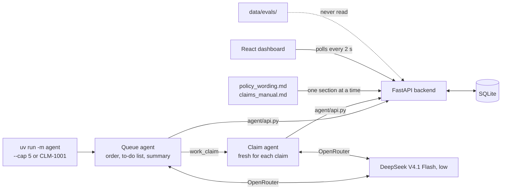
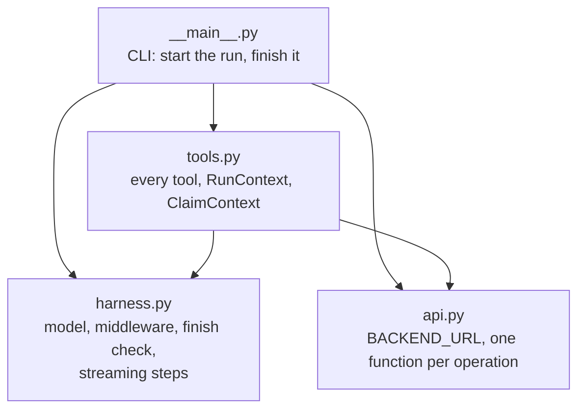
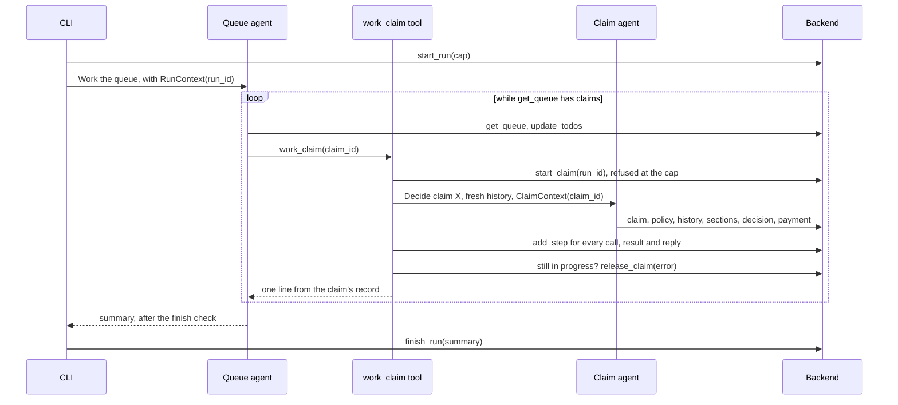
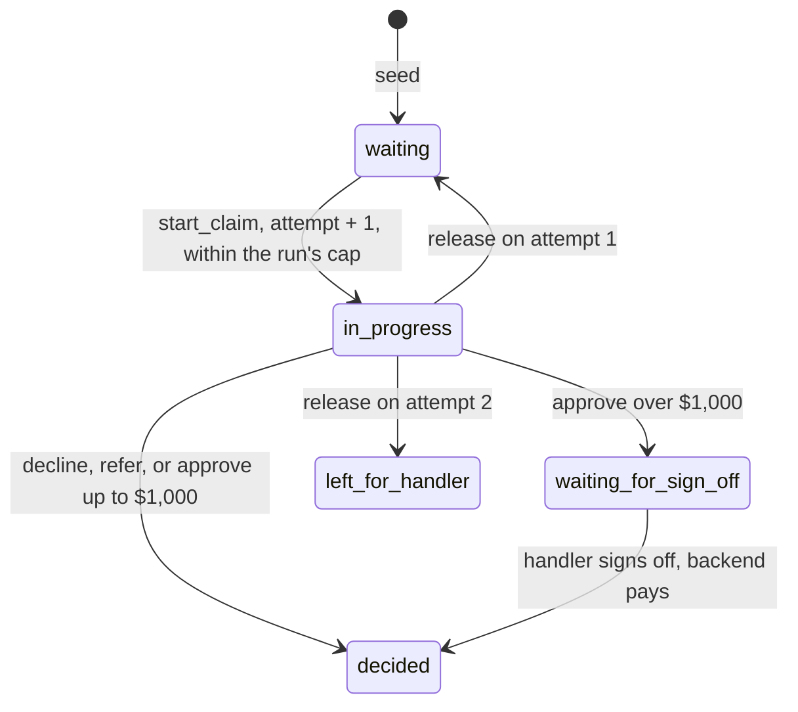
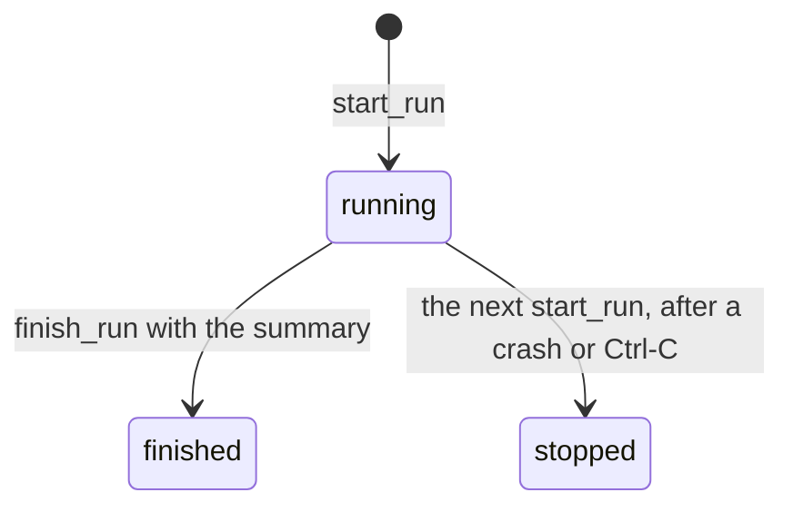

# Plan: the harness

Builds `docs/HARNESS.md` on the pilot (`docs/PLAN.md`, `docs/STATUS.md`), in six phases. For each phase: build it with tests, check every criterion, tick it here, update `docs/STATUS.md`, commit. Any live run with the real model reseeds first and is capped at five claims.

## Sources

| Document | What it gives this plan |
|---|---|
| `docs/HARNESS.md` | The seven asks and what done looks like |
| `docs/HUMAN_REVIEW_HARNESS.md` | A review of an earlier harness build (`queue.py`, `tools.py`, `run_queue`). None of those files exist on this branch, so its four points shape the layout from the start: one `api.py`, every tool in `tools.py` on `ToolRuntime` context, the harness in `harness.py`, instructions that give a goal. Its updates to `PROCESS.md` and `CODE_STANDARDS.md` are Phase 1 criteria |

What the review's points find on this branch today:

| Review point | On this branch |
|---|---|
| 1. Hard-coded URLs | Agent: 10 API paths across `main.py` and `__main__.py`. Dashboard: 8 paths across 4 components |
| 2. Modules reach into each other | `agent/__main__.py` calls `agent.main.backend()` and `agent.main.run()` |
| 3. Tools and harness mixed together | Tools are closures inside `make_tools(claim_id)`; tools, streaming and steps share `main.py` |
| 4. Scripted instructions | `backend/instructions.md` is a numbered five-step script |
| Backend | 13 routes each repeat `/api`; routes, SQL helpers and config share one 227-line `main.py` |

How it was allowed: every criterion in `docs/PLAN.md` checked behavior (tests, curl, the browser) and none checked structure, and `CODE_STANDARDS.md` says nothing about module boundaries. A build could pass every check and still be badly organized. Phase 1 adds rules for structure, and every phase from then on has criteria that check it.

## How it fits together

The agent's modules. Imports point one way, and `harness.py` imports nothing from `agent/`:

One run:

## Claim and run lifecycles

| Claim status | Label | Color |
|---|---|---|
| `waiting` | Waiting | Cerulean |
| `in_progress` | In progress | Marigold |
| `waiting_for_sign_off` | Waiting for sign-off | Coral |
| `decided` | Decided | Sea Green |
| `left_for_handler` (new) | Left for a handler | Raspberry, fifth in BRAND's order |

| To-do status | Label | Color |
|---|---|---|
| `to_do` | To do | Cerulean |
| `in_progress` | In progress | Marigold |
| `done` | Done | Sea Green |
| `left_for_handler` | Left for a handler | Raspberry |

## Key decisions

| Decision | Why | Rejected |
|---|---|---|
| The guarantees are code and the organizing is the agent's. Code: the cap, a retry after a failure, never deciding or paying twice, the check for missed claims. Agent: the order, the to-do list, the summary | The brief asks the agent to organize its own work, but a trial's cost and a claim's safety can't rest on a prompt | Retries and the cap in the instructions only |
| Recovery reads the claim, not the reply. When the claim agent ends, by an error or not, `work_claim` reads the claim and releases it if it is still in progress | One rule covers timeouts, provider errors, failed tools, a hit step limit and a model that stops without deciding | Catching each error type |
| `release_claim` lives in the backend: attempt 1 goes back to waiting, attempt 2 to `left_for_handler`. The error is kept on the claim and posted as a step | Attempts are counted where the claims are, so they hold across runs | A counter in the agent |
| A claim that is decided but whose payment failed is not retried | Never decided twice. Its one-line report and the summary name it, and the claim page shows Not paid | Rolling back the decision |
| The cap is enforced by `start_claim` in one conditional `UPDATE`: a run holds at most `cap` claims, and retrying one of its own doesn't count again | Same pattern as the $1,000 rule: the backend refuses whatever the agent does. A single statement, so two `work_claim` calls at once can't both pass | A counter in the harness |
| `start_run` stops any run still running and releases its claims in progress. One run at a time | A run that crashed, was killed or was stopped with Ctrl-C leaves nothing stuck, with no cleanup code in the agent | Releasing in the CLI on exit, which misses a killed process |
| The wording leaves the system prompt, a change from `docs/PLAN.md`. Both documents are read by section: `list_sections` gives the contents, including the bold topics inside a section, and `read_section` gives one section | Brief item 4: "rather than being handed whole documents". The topics make the manual's section 7 notes, such as Wild animals, findable from the contents | Keeping the wording in the prompt; keyword search; embeddings (Week 2) |
| The sections API serves exactly two documents, named in code: `policy_wording` and `claims_manual` | The document is a path parameter. A fixed list means nothing else in `data/`, such as `evals/` or `security/`, can be read through it | A filename parameter |
| `claim_id` and `run_id` come from `ToolRuntime` context, never from a model argument | Review point 3, and it keeps the pilot's least privilege: a claim agent can only touch its own claim | Closures in `make_tools(claim_id)`, as in the pilot |
| Our own `write_todos` tool posts the list to the backend, with four statuses | The dashboard reads the backend. LangChain's `TodoListMiddleware` keeps the list in agent state, with no "left for a handler" | `TodoListMiddleware` |
| The subagent is a tool, `work_claim`, that runs a fresh `create_agent` for each claim. Its one-line report is written by code from the claim's record | A clean history keeps each claim's steps cheap, and a report built from the record is always right | Deep Agents' `task` tool (another framework); the subagent writing its own report |
| One retry layer for the model: `ChatOpenAI(timeout=120, max_retries=5)` | The OpenAI client already retries timeouts, rate limits and server errors with backoff (Lab 2's settings). What still fails fails the claim, and recovery handles that | `ModelRetryMiddleware` as well; its default turns a final failure into a reply |
| Step limits: `recursion_limit` of 50 for a claim agent and 500 for the queue agent | LangGraph's default of 25 graph steps would stop a queue run partway. A claim over its limit fails and is released | The default |
| A tool's 4xx goes back to the model as text through `ToolErrorMiddleware`; anything else raises | `api.py` stays plain and raises on any error; what the model sees is decided in one place in the harness | The pilot's `call()` returning text |
| The finish check is an `after_model` hook. When the queue agent replies without a tool call and `get_queue` still has claims, it reminds the agent and sends it back, at most twice | The brief's check for missed claims, testable on a stub model. It ends because a claim gets at most two attempts and the cap bounds new ones | Trusting the instructions alone |
| Thread ids stay in the agents' config: the run id for the queue agent, `{run_id}-{claim_id}-{attempt}` for a claim agent. `TECH_STACK.md`'s entry point becomes the three commands below, in Phase 6 | There is no checkpointer yet, but Week 2 Day 3's durable state will key on them, and they cost nothing | Dropping them |
| Named claims skip the queue agent: `uv run -m agent CLM-1001` starts a run capped at the number named and works each claim once through `work_claim` | Checking one claim stays deterministic and cheap | The queue agent on a restricted queue |
| Instructions give a goal and rules, not steps, and the payout limit is filled in from `data/company.json` | Review point 4. Also fixes the pilot's "$1,000" typed into the prompt | Numbered scripts |
| Structure: the backend is split by resource (`claims.py`, `runs.py`, `documents.py`) with `/api` written once in `main.py`; every dashboard API path is in `api.ts` | The same rule in all three apps: one place knows the URLs | Paths in every route and component |
| Playwright runs one worker | The queue page shows the latest run and `start_run` stops the one before, so specs that start runs would interfere in parallel | Parallel specs, as in the pilot |

## API changes

Every operation keeps an `operation_id`, a one-line docstring and no optional inputs.

| `operation_id` | Route | Input | What it does |
|---|---|---|---|
| `start_run` | `POST /api/runs` | `cap` | Stops a running run and releases its claims in progress, then starts a run |
| `get_latest_run` | `GET /api/runs/latest` | | The latest run, or `null` |
| `get_queue` | `GET /api/runs/{run_id}/queue` | | Waiting claims the run may still take: any, until it holds `cap` claims, then only its own |
| `update_todos` | `PUT /api/runs/{run_id}/todos` | `todos` | Replaces the to-do list of a running run |
| `finish_run` | `POST /api/runs/{run_id}/finish` | `summary` | Running to finished |
| `start_claim` (changed) | `POST /api/claims/{claim_id}/start` | `run_id` | 409 if the claim isn't waiting, the run isn't running or the run is at its cap. Adds 1 to `attempts`, clears `error` |
| `release_claim` | `POST /api/claims/{claim_id}/release` | `error` | In progress to waiting (attempt 1) or `left_for_handler` (attempt 2), with an `error` step. 409 otherwise |
| `list_sections` | `GET /api/documents` | | Both documents' sections: number, title, topics |
| `read_section` | `GET /api/documents/{document}/sections/{section}` | | One section's text. `document` is `policy_wording` or `claims_manual` |
| `get_instructions` (changed) | `GET /api/instructions` | | `queue` and `claim`, with no policy wording |

A run is `run_id`, `cap`, `status` (`running`, `finished`, `stopped`), `todos`, `summary`, `started_at` and `finished_at`. A to-do is `content` and `status`. A claim adds `attempts`, `error` and `run_id`. Steps add the kind `error`.

## The agent

| Tool | Agent | Calls | From context |
|---|---|---|---|
| `get_queue()` | queue | `get_queue` | `run_id` |
| `write_todos(todos)` | queue | `update_todos` | `run_id` |
| `work_claim(claim_id)` | queue | `start_claim`, a fresh claim agent, `add_step`, `release_claim` | `run_id` |
| `get_claim()` | claim | `get_claim` | `claim_id` |
| `get_policy(policy_id)` | claim | `get_policy` | |
| `get_claim_history(customer_id)` | claim | `get_claim_history` | |
| `list_sections()` | claim | `list_sections` | |
| `read_section(document, section)` | claim | `read_section` | |
| `record_decision(decision, payout, rationale, policy_section)` | claim | `record_decision` | `claim_id` |
| `pay_claim(amount)` | claim | `pay_claim` | `claim_id` |

No tool signs off. `RunContext` holds `run_id` and the model for claim agents, so tests pass a stub for each agent. `ClaimContext` holds `claim_id`.

`work_claim` reports one line from the claim's record:

| Outcome | Line |
|---|---|
| Approved and paid | `CLM-1007 approve $215.00, paid` |
| Approved over the limit | `CLM-1003 approve $3,750.00, waiting for sign-off` |
| Declined or referred | `CLM-1010 refer` |
| First failure | `CLM-1012 failed: ReadTimeout. Back in the queue, attempt 1 of 2` |
| Second failure | `CLM-1012 failed twice: ReadTimeout. Left for a handler` |

| Command | What it does |
|---|---|
| `uv run -m agent` | One run over the whole queue: its cap is the number of claims in the queue, a maximum it can't exceed |
| `uv run -m agent --cap 5` | One run that takes at most five claims; the rest stay waiting |
| `uv run -m agent CLM-1001` | Works the named claims, once each, without the queue agent |

Draft of `backend/instructions/queue.md`:

> You are the UnderCover Agent. You run the claims queue at UnderCover Travel Insurance for its claims handlers.
>
> Your goal: every claim this run can take gets decided, and the handlers know where things stand when you finish.
>
> - Keep a to-do list with write_todos, so the team can see what you mean to do and how far you have got.
> - get_queue shows the claims you can still take. The order is yours to choose.
> - work_claim hands one claim to a claims handler who starts fresh, and reports back in a line. A claim that fails goes back in the queue and can be tried again. A claim that fails twice is left for a handler.
> - When nothing is left for you, finish with a short summary for the handlers: what was decided, which payouts wait for their sign-off, and which claims they need to pick up and why.

Draft of `backend/instructions/claim.md`:

> You are a claims handler at UnderCover Travel Insurance. Decide the claim you are given as an experienced handler would: approve it with the right payout, decline it or refer it.
>
> The policy wording is the contract and comes first. The claims manual covers what the wording leaves open. Both are long, so find the sections that bear on this claim with list_sections and read them with read_section. Base the decision on what you read.
>
> - Record one decision with record_decision: two or three sentences of rationale, the section it rests on, and the payout in US dollars (0 unless you approve).
> - Refer only for the reasons the manual gives.
> - Pay an approval of {payout_limit} or less with pay_claim. A larger payout waits for a handler's sign-off, and the system will refuse to pay it.
> - Finish with one sentence on what you decided.

## Phase 1: Clean foundations

**Builds:**

- `docs/CODE_STANDARDS.md`, new rules:
  7. Each app has one module that talks to the backend: `agent/api.py` and `dashboard/src/api.ts`. The base URL and every path are there, and no other module builds a URL. The backend writes `/api` once.
  8. Imports point one way. Nothing imports an entry point, and nothing reaches into another module's private names.
  9. In the agent, every tool is in `tools.py` and reads run state from `ToolRuntime` context. `harness.py` holds the agent machinery and no UnderCover rules.
  10. Agent instructions give a goal and the rules around it, not numbered steps.
- `docs/PROCESS.md`: plans include criteria that check structure as well as behavior. Before each commit, review the phase's diff against `docs/CODE_STANDARDS.md` and fix what a pull request review would reject.
- `agent/api.py`, `agent/tools.py` (the pilot's five tools, on `ToolRuntime[ClaimContext]`), `agent/harness.py` (model, building an agent, streaming steps, the refusal middleware), `agent/__main__.py`. `agent/main.py` is removed. Otherwise the behavior is the pilot's.
- Default model: `deepseek/deepseek-v4.1-flash` with low reasoning effort, `timeout=120`, `max_retries=5`. `MODEL_NAME` overrides it.
- Backend: `claims.py` and `documents.py` routers, and `main.py`, which wires them under one `APIRouter(prefix="/api")`. No route changes.
- Dashboard: `paths` in `api.ts`; components use it.

**Why first:** every later phase adds to these modules, so they start clean, under the pilot's green tests.

- [x] `docs/CODE_STANDARDS.md` and `docs/PROCESS.md` hold the rules above
- [x] `grep -rn '"/api' agent --include='*.py'` prints matches only in `agent/api.py` and `agent/tests/`
- [x] `grep -rn '"/api' backend --include='*.py'` prints one line outside `backend/tests/`, in `backend/main.py`
- [x] `` grep -rnE '["`]/api' dashboard/src --include='*.tsx' `` prints matches only in test files
- [x] `grep -nE "^(from|import) agent" agent/harness.py` prints nothing, and `grep -rnE "agent\.__main__|from agent import __main__|agent\.main" agent --include='*.py'` prints nothing outside `agent/tests/`
- [x] Test: none of the claim agent's tools takes `claim_id` as an argument; it comes from context
- [x] Test: the default model is `deepseek/deepseek-v4.1-flash` with reasoning effort low; `MODEL_NAME=openrouter/free` gives that model with no reasoning effort
- [x] The pilot's stub-model and CLI tests pass with the same assertions, moved to the new modules
- [x] `npm run check` passes

## Phase 2: The wording and the manual, section by section

**Builds:**

- `backend/documents.py`: the two documents split at their `## N. Title` headings, with the `**Topic.**` leads inside each section as its topics. `list_sections` and `read_section`.
- The claim agent's `list_sections` and `read_section` tools.
- `backend/instructions/claim.md` replaces `backend/instructions.md`, from the draft above. `get_instructions` returns `claim`, with `{payout_limit}` filled in from `data/company.json` and no policy wording.
- Claim page: a "What the agent read" panel, built from the `read_section` results in the steps.
- Instructions page: "Working a claim".
- `docs/SPEC.md`: the claims manual leaves "Not for now". Decisions follow the wording first, and the manual where the wording leaves things open.

**Why now:** it changes only the claim agent, which the queue agent will hand claims to.

- [x] pytest: `GET /api/documents` lists 12 wording sections and 14 manual sections; manual section 7 has the topic "Wild animals" and wording section 8 has "Electronics Plus"
- [x] `curl localhost:8000/api/documents/claims_manual/sections/10` returns "Meals without receipts" and its text, including "$35 per traveler"
- [x] pytest: an unknown section returns 404, and a document outside the two, such as `customers`, returns 422; `curl localhost:8000/api/documents/evals/sections/1` returns 422 with no content from `data/` (the tests avoid the word `evals`, so the grep below stays meaningful)
- [x] pytest: the `claim` instructions hold "$1,000.00", don't hold the wording's "## 1. Your plan", and have no numbered lines
- [x] Stub-model test: a claim agent that calls `list_sections` and `read_section("claims_manual", 7)` records both as steps, with the section's text as the result
- [x] vitest: the claim page lists "Claims manual, 7. Interpretation notes" under What the agent read
- [x] e2e: the instructions page shows "Working a claim" and not the policy wording (replaces the pilot's expectation)
- [x] e2e: with a claim page open, the test posts a `read_section` call and result as steps, and the section appears under What the agent read with no reload
- [x] `docs/SPEC.md` no longer lists the claims manual under "Not for now"
- [x] `grep -rln evals backend agent` prints nothing
- [x] `npm run check` passes

## Phase 3: Runs, the cap and recovery in the backend

**Builds:**

- Schema: a `runs` table; on claims, `attempts`, `error` and `run_id`; the step kind `error`; the status `left_for_handler`.
- `backend/runs.py`: `start_run`, `get_latest_run`, `get_queue`, `update_todos`, `finish_run`.
- In `backend/claims.py`: `start_claim` takes `run_id` and checks the cap; `release_claim`.
- The CLI starts a run, capped at the claims it will work, and passes its `run_id` (the queue agent replaces this loop in Phase 4).
- e2e specs that start a claim start their own run first. `playwright.config.ts` runs one worker.
- Dashboard: `left_for_handler` in `STATUSES` (`api.ts`), `STATUS_LABELS` (`format.ts`) and its Raspberry color (`styles.css`), so the dashboard can label every status the backend returns.

**Why now:** the guarantees are backend code, tested without any model, before an agent depends on them.

- [x] pytest, **the cap on a run**: a run with a cap of 2 starts two claims; a third returns 409 "Run 1 has reached its cap of 2"; restarting one of its own released claims is allowed
- [x] pytest: starting a claim in a finished or stopped run returns 409; `attempts` counts each start
- [x] pytest, **a failed claim goes back in the queue**: releasing a claim on attempt 1 makes it waiting, keeps the error and posts an `error` step
- [x] pytest, **a claim that fails twice is left for a handler**: releasing on attempt 2 makes it `left_for_handler`, and starting it again returns 409
- [x] pytest, **never decided or paid twice**: releasing a decided or waiting claim returns 409; a second decision and a second payment return 409, as before
- [x] pytest: `start_run` stops a running run and releases its claims in progress, counting the attempt
- [x] pytest, **the to-do list stored**: a to-do list put on a run comes back in order from `get_latest_run`; an unknown status returns 422; changing a finished run's list returns 409
- [x] pytest: `get_queue` returns every waiting claim until the run holds its cap, then only its own waiting claims, and never a decided or left-for-handler claim
- [x] pytest: `finish_run` stores the summary; finishing twice returns 409; `get_latest_run` is `null` before any run
- [x] pytest: the OpenAPI walk still finds an `operation_id`, a one-line description and only required inputs on every operation
- [x] curl walk-through: start a run with a cap of 1, start CLM-1001, then CLM-1002 returns 409; release CLM-1001, start and release it again, and it shows `left_for_handler` with the error. Reseed afterwards
- [x] `npm run e2e` passes twice in a row
- [x] `npm run check` passes

## Phase 4: The queue agent and a fresh claim agent per claim

**Builds:**

- `tools.py`: `RunContext`; `get_queue`, `write_todos` and `work_claim`, which starts the claim, runs a fresh claim agent with `recursion_limit` 50, posts its steps, reads the claim, releases it if still in progress and returns the line.
- `harness.py`: the finish check (`after_model`, at most two reminders). The queue agent runs with `recursion_limit` 500.
- `backend/instructions/queue.md` from the draft. `get_instructions` returns `queue` and `claim`, and the instructions page shows "Running the queue" too.
- `__main__.py`: the three commands above. It prints each `work_claim` line as it comes, then the summary, and finishes the run.

**Why now:** the backend's guarantees and the claim agent are both in place.

- [x] Stub-model test, **one run works the queue**: the queue model writes a to-do list, works two claims and ends with a summary; both claims are decided, and the run is finished with that summary and the list
- [x] Stub-model test, **the cap on a run**: with `--cap 2`, a third `work_claim` gets the refusal as text, and the other claims stay waiting
- [x] Stub-model test, **a failed claim that does not stop the run**: the claim model raises a timeout on CLM-1001; the run goes on and decides CLM-1002; CLM-1001 is waiting with the error, and its steps up to the failure are on it
- [x] Stub-model test, **a failed claim going back in the queue and being tried again**: a second `work_claim` on CLM-1001 decides it, with 2 attempts
- [x] Stub-model test, **a claim that fails twice left for a handler**: two failures leave it `left_for_handler`, the line says so, and the run still finishes
- [x] Stub-model test: a claim model that stops without a decision is released like an error, and one that loops past 50 steps is released too
- [x] Stub-model test, **the check for missed claims**: the queue model tries to finish while `get_queue` still has a claim; its next prompt holds a reminder naming it; it works the claim and finishes. A model that keeps trying to finish stops after two reminders
- [x] Test: every claim agent's first prompt is the system prompt and "Decide claim X." only, whatever came before
- [x] Test: the queue agent's tools are exactly `get_queue`, `write_todos`, `work_claim`; the claim agent's are the seven above; none signs off
- [x] Test: `--cap 5` starts a run with a cap of 5; named claims skip the queue agent and print one line each
- [x] pytest: `GET /api/instructions` has `queue` and `claim`, neither with numbered lines
- [x] e2e: the instructions page shows "Running the queue" and "Working a claim"
- [x] Phase 1's grep criteria still hold
- [x] `npm run check` passes

## Phase 5: The run on the dashboard

**Builds:**

- Queue page: a Current run panel with the run's number, status (Running, Finished, Stopped), cap, the to-do list with a badge per item, and the summary once finished. "No runs yet." before the first run. Polls every 2 s.
- The fifth status, added to the types in Phase 3, on the page: its tile on the queue, and the vitest and e2e counts.
- Claim page: attempts and the last error when a claim is waiting after a failure or left for a handler; `error` steps with a Failed badge.

**Why now:** the API it shows is complete and tested.

- [ ] vitest, **the to-do list shown**: the queue page shows each item with its status label and the summary once finished; "No runs yet." when there is no run
- [ ] vitest: five status tiles, with Left for a handler counted
- [ ] vitest: a claim left for a handler shows its error and "2 of 2 attempts"; an `error` step shows Failed
- [ ] e2e: the test starts a run and puts a to-do list on it, then marks an item done; the queue page shows the list filling in and the item ticked off with no reload, and the summary after `finish_run`
- [ ] e2e: a claim started and released twice shows Left for a handler on the queue and its error on its page
- [ ] Playwright MCP on localhost:5173, light and dark (emulated), screenshot each: the run panel, the five tiles and a claim left for a handler. Reseed afterwards
- [ ] `npm run check:ts` and `npm run e2e` pass

## Phase 6: A trial on five claims, and the docs

**Builds:** no new features. `docs/SPEC.md`, `docs/TECH_STACK.md` and `docs/STATUS.md` describe the product as it now is: the model, the commands, the harness, the manual and the fifth status.

**Why last:** the first run with the real model, checked by structure, not accuracy.

- [ ] With `npm run dev` up: `uv run -m backend.seed`, then `uv run -m agent --cap 5` works five claims on its own and prints five lines and a summary (about 3 cents on DeepSeek V4.1 Flash)
- [ ] Playwright MCP during the run: the queue page's to-do list fills in and its items are ticked off; a claim page shows its steps and the sections the agent read
- [ ] `curl localhost:8000/api/claims`: 20 claims waiting, none in progress, and the run's five decided, waiting for sign-off or left for a handler
- [ ] Every claim the run decided has at least one `read_section` step. This is a spot check of the model's behavior, not a code guarantee: if it fails, read the steps, and change the instructions only for a reason that holds across claims
- [ ] Every approval over $1,000 is waiting for sign-off and unpaid; every other approval is paid exactly its payout
- [ ] `npm run check` passes, and the worked queue is unchanged afterwards
- [ ] `docs/SPEC.md`, `docs/TECH_STACK.md` and `docs/STATUS.md` match the build
- [ ] Report: the five lines, the summary, the cost and the time

> The pilot's real-model checks were blocked by a Netskope proxy policy on the build machine. Before this phase, send one chat request to OpenRouter. If it is still blocked, the live criteria stay unticked with a note, and the docs and `npm run check` are still done.

## Not in this plan

| Left out | Why |
|---|---|
| Scoring against `data/evals/` | Evaluations come with a later brief, and PROCESS says not to open `data/evals/` |
| Durable state, a checkpointer | Week 2 Day 3 |
| Starting a run from the dashboard | The brief asks the team to watch the run, not start it |
| A handler deciding a claim left for a handler | Not asked; reseed resets it |
| Summarizing the queue agent's history | A few lines per claim fit easily for 25 claims; the claim work, which grows, stays in the claim agents |
| Real payments, messages to customers | SPEC |
